# Woolgather

**Herd the flock home before nightfall.** A cosy-tense sheepdog game in the browser, built with
Vite, TypeScript and Three.js.

**[Play it in your browser](https://woolgather.pages.dev/play/)** (free, no install, desktop browser
with a keyboard or a gamepad) and see the **[landing page](https://woolgather.pages.dev/)** for
gameplay video of a whole evening, uncut, and a small herding toy to try the one rule.

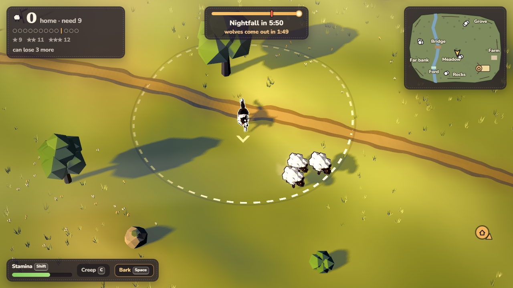

You are Pip, a border collie in a highland valley at golden hour. The flock has scattered across
the hills, the sun is going down, and when it sets the wolves come out. Herd every sheep you can
into the stone fold by the farmhouse before night falls.

Sheep are a real flock: they graze, bunch together when nervous and flee from you as a group. You
steer them by *where you stand*, not by pushing them one at a time. Creep up quietly, get behind
the flock, drive it over the bridge and through the fold gate. When the gold turns to a rose sunset
the wolves slip out of the pines to snatch stragglers: chase them off or bark them away before they
drag a sheep into the trees. Night falls in violet and moonlight.

| | |
| --- | --- |
| 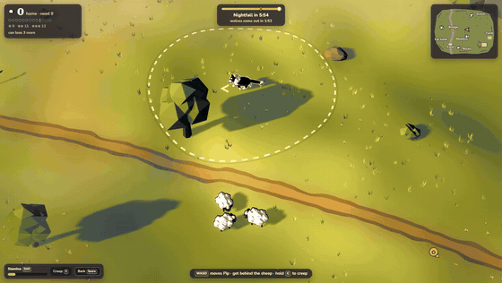 | 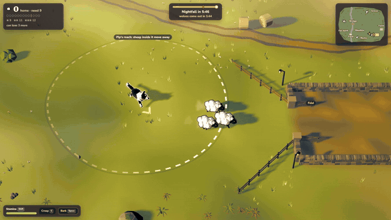 |
| **Get behind them.** Swing wide round the far side of a flock and walk in: it moves off away from Pip. | **Through the gate.** Every sheep that makes it into the stone fold gets a gold heart. |
| 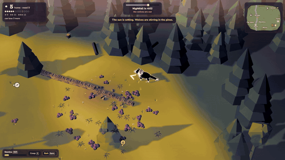 | 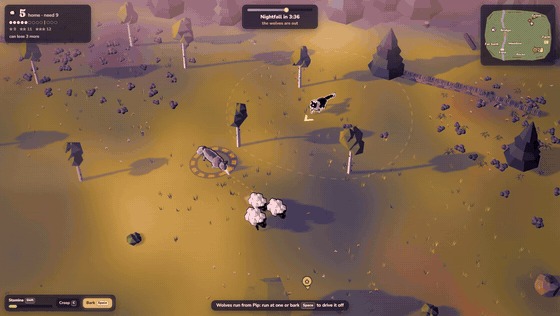 |
| **The sun goes down.** The light is the clock: at the red notch on the sun bar the gold turns to rose. | **The wolves come out.** A red ring marks each wolf, and a dashed line runs to the sheep it wants. |
| 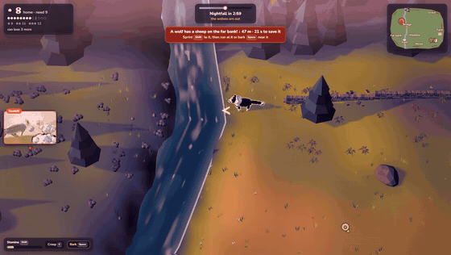 | 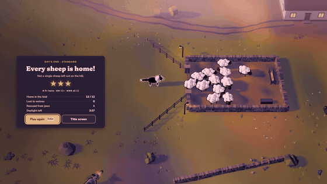 |
| **Snatch!** A banner counts down the seconds. Sprint over and run at the wolf or bark: it drops the sheep. | **Home before dark.** Every sheep in the fold, three stars. |

The clips are the finished game, recorded one frame at a time at 60 fps while the test bot played
one Standard evening (see [Footage](#footage)); in that evening it brought all twelve home in 3:33.

## The Season (Woolgather 2)

Version 2 turns one evening into a season: **ten evenings on one hill farm**, midsummer to the first
snow, over **five places**, each evening adding one new thing to herd around.

| # | Evening | Place | New tonight |
| --- | --- | --- | --- |
| 1 | Long Light | Hollow Valley | herding, and one early wolf |
| 2 | The Far Bank | Hollow Valley | crossings: the bridge and the ford |
| 3 | Lambing Time | Loch Ailsa | lambs that follow their mothers, and a lost lamb |
| 4 | Old Angus | Crannach Corrie | the ram, who must be stared down; wolves that hunt as a pack |
| 5 | The Glenbrae Trial | Glenbrae Show Field | a sheepdog trial: gates in order, judged on points |
| 6 | Night Watch | Loch Ailsa | guard the flock until dawn |
| 7 | Mist on the Moor | The High Pass | mist: find the flock by its bleating |
| 8 | The Storm | Hollow Valley | thunder that scatters the flock, and a flood |
| 9 | The Gathering | The High Pass | every flock off the hill, with Old Fly to help |
| 10 | First Snow | The High Pass | everything at once |

- **Easy, Standard or Hard** (2.1), chosen on the season map or any evening's card. The first
  evening is the same on all three. Harder means more to think about, not only more wolves:
  - **Easy:** more daylight, the wolves later and alone.
  - **Standard:** the evening as written, with its kinds of wolf.
  - **Hard:** less daylight, wolves that hunt in pairs from the third evening, more old greys,
    every wolf you chase off comes back once, and each evening adds something from an earlier one
    (a black sheep on the far bank, lambs with Old Angus, the ram up in the mist, lambs in the storm).
- **Wolves by kind.** The **old grey** is bigger and bolder: he only hears a bark from close by, and
  one bark only staggers him; bark again while he is shaken, or run straight into him. **Young
  wolves** are quick and nervy and bolt at one bark, but they come back from another side of the
  valley. From Old Angus on (sooner on Hard) wolves hunt in pairs: one shows itself on your side
  of the flock and feints, while its mate circles round to the far side and waits for you to take
  the bait.
- **Stars, ribbons and Wolf Moon.** Every evening has three stars and a ribbon (an optional
  challenge). Three stars open its **Wolf Moon**: the same evening shorter, with one more wolf, a
  full pack and one more sheep needed.
- **Charms** are bought with stars. Some are small edges (faster paws, a gruffer bark); three change
  how you play: **The Outrun** (Z and X together: a wide run to the far side of a loose flock),
  **Old Fly** (F: Pip's mother lies down where he stands and holds that spot, so the sheep keep off
  it) and **The Bell-wether** (the flock keeps close round a ewe with a bell, and you can hear her in
  the mist).
- **Pip's coats** are won with ribbons and Wolf Moon stars. Win every evening of the season and
  the last swatch in the row is not a coat at all: a **goose** will herd in Pip's place. It honks.
- **Today's evening:** a new evening every day, made from the date: a place, the real season, the
  weather, two or three flocks.
- **Classic evening** is the 1.0 game, at Gentle, Standard or Hard.

| | |
| --- | --- |
| 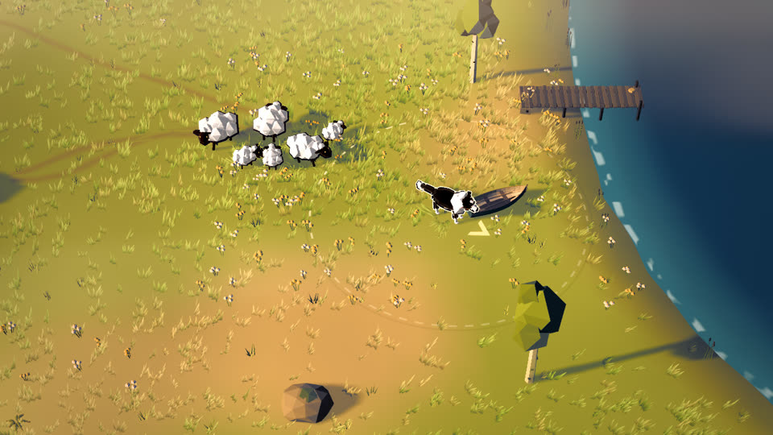 | 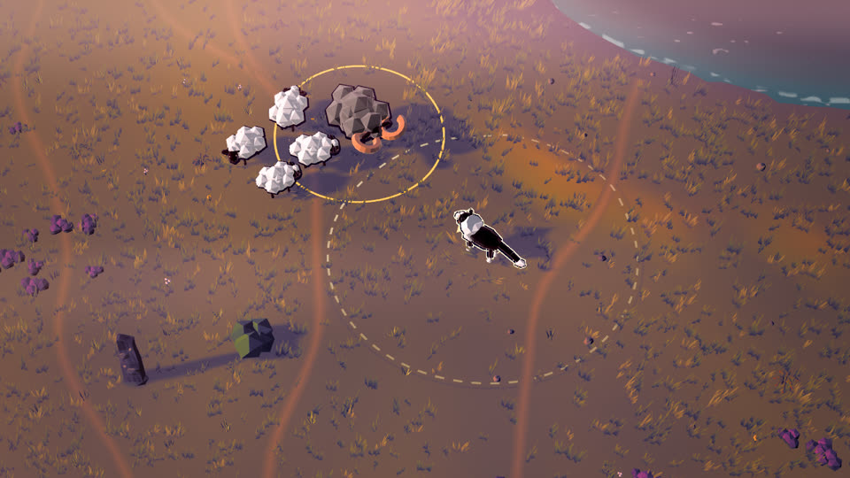 |
| **Lambing Time** on Loch Ailsa | **Old Angus** in Crannach Corrie |
| 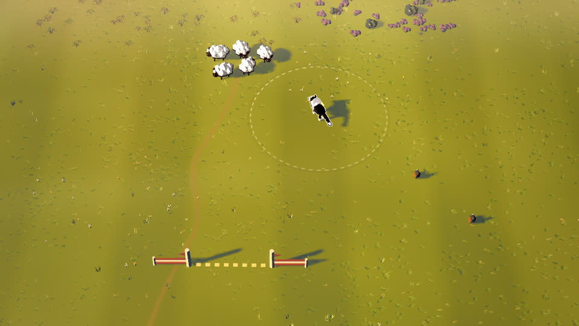 | 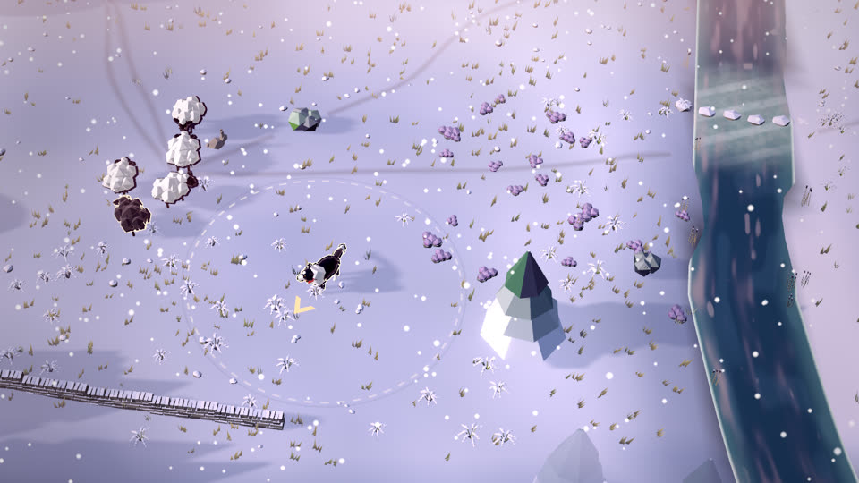 |
| **The Glenbrae Trial** | **First Snow** on the High Pass |

Each place has its own ground and landmarks: a green machair with a jetty on Loch Ailsa, a heather
moor under crags and screes in Crannach Corrie, standing stones and a stell in Hollow Valley, a mown
show field with a crowd and a judges' box at Glenbrae, a stony pass with cairns and peat hags.
Weather runs from midsummer gold to rain, mist and snow, with a recorded score and sound.

## Play it

Online: **https://woolgather.pages.dev/play/**. To run it locally (Node 20 or newer, a browser with
WebGL 2):

```bash
npm install
npm run dev
```

Then open http://localhost:5317/ (the port is fixed so it never collides with the sibling games in
the parent folder). For the production build:

```bash
npm run build
npm run preview
```

and open http://localhost:4317/.

## Controls

| Action | Keyboard | Gamepad |
| --- | --- | --- |
| Move Pip | WASD or arrow keys | Left stick |
| Sprint (uses stamina) | Shift | RT or RB |
| Creep: sheep stay calm until you are close | C (hold) | LT or LB |
| Lie down: the flock stops and settles | Q (hold) | B |
| Flank: run round the nearest flock ("away" / "come bye") | Z or X (hold) | D-pad left or right |
| Outrun (charm) | Z and X together (hold) | Left stick click |
| Old Fly: lie down here, or come back (charm) | F | D-pad down |
| Bark: startles sheep, scares wolves off (the old grey takes two) | Space or B | A or X |
| Latch the gate once enough sheep are home | Enter | Y |
| Pause (sound and graphics settings) | Esc or P | Start |
| Sound on or off | M | |

Menus work with the mouse, the keyboard (arrows or WASD move between buttons, Enter chooses, left
and right pick the evening on the title) or a gamepad (d-pad or stick, A chooses).

## How to play

- Sheep move **away** from Pip. Stand on the far side of a flock from where you want it to go and
  it trots on ahead of you. The dashed ring round Pip is his reach: sheep inside it move away.
  Creeping shrinks it, sprinting grows it, a bark startles everything near.
- Sheep will not wade the stream: cross at the wooden bridge or the shallow ford.
- Drive them through the gate of the stone fold by the farmhouse. The counter shows how many are
  home, the target, a pip for every sheep and how many more you can afford to lose.
- When the sun sets (the red notch on the sun bar) wolves come out of the pines for stragglers.
  Run at a wolf or bark and it drops its prey. A snatch out of sight shows in a close-up at the
  left edge, with the time left to save the sheep.
- Once the target is met, Enter latches the gate and ends the day; or keep herding for more stars.
- You win when every sheep still yours is in the fold (with at least the target), when night falls
  with the target met, or when you latch the gate early. You lose if night falls before the target
  is met, or if the wolves take so many that the target is out of reach.

| Evening | Sheep (need) | Length | Wolves |
| --- | --- | --- | --- |
| Gentle | 12 (9) | 8.5 minutes | from halfway, one at a time |
| Standard | 12 (9) | 6 minutes | after 2 minutes, up to two |
| Hard | 16 (13) | 5 minutes | after 1 minute, up to three, faster |

## Screenshots

| | |
| --- | --- |
| 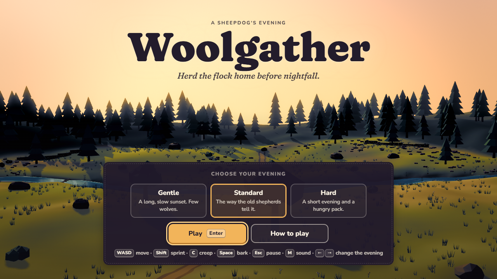 | 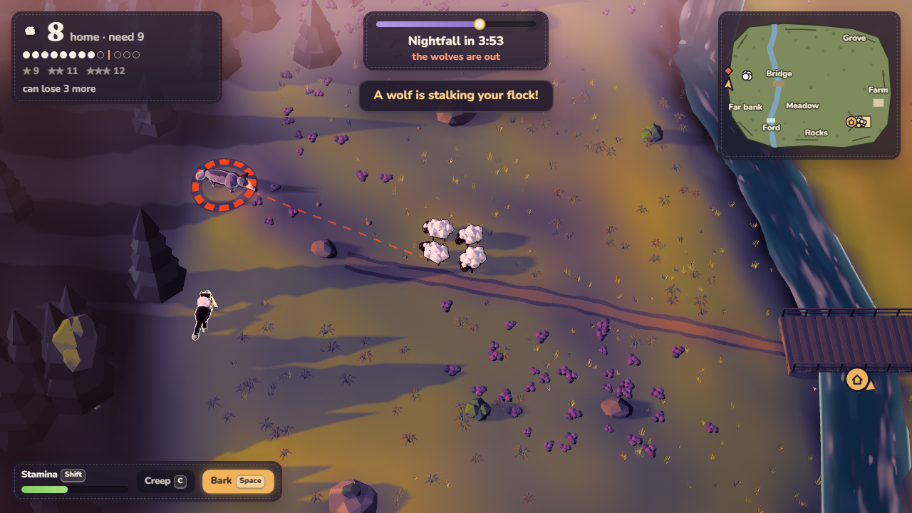 |
| 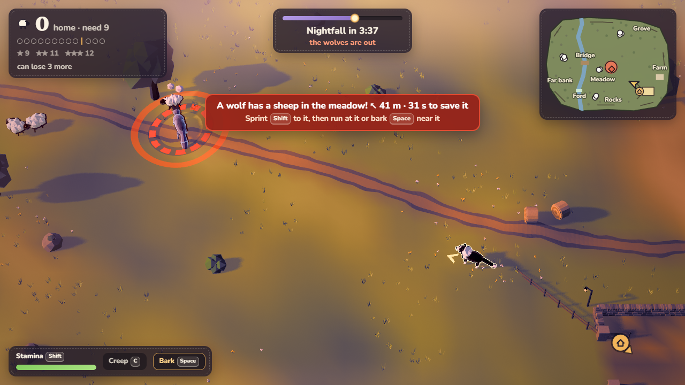 | 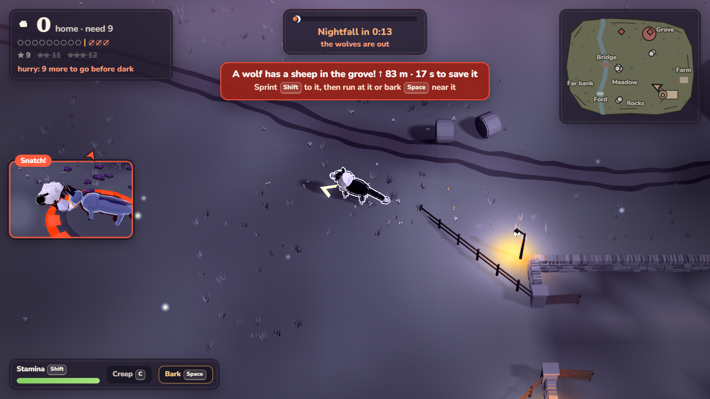 |

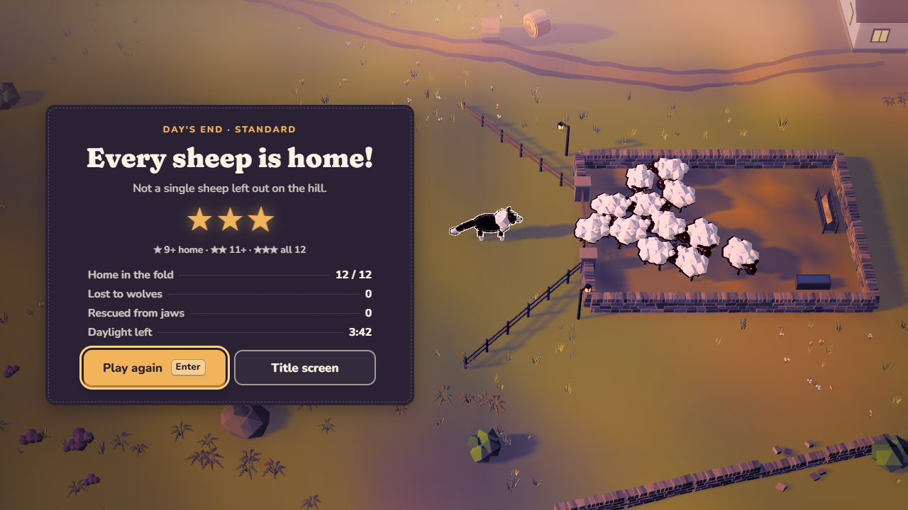

## Settings

The pause menu has volume, music and effects sliders, a mute switch and the graphics choice:
**Auto** (the default) starts at High and steps down a tier while the game runs below about 52
frames a second; **High**, **Medium** and **Low** fix the render resolution, multisampling, shadow
map size and bloom. Both choices are remembered. `?quality=low` in the URL picks a tier too.

## How it was made

- **Models:** every model was made in Blender (5.1) by the Python scripts in `blender_scripts/`, one
  per asset family (characters, nature, structures, terrain, effects), and exported to
  `public/assets/` as glTF binaries. During development the scripts ran through the Blender MCP in
  headless Blender processes; `npm run assets` rebuilds them all (needs Blender on PATH or in
  `BLENDER_PATH`). The level layout (`level/valley.json`) is shared by the terrain script and the
  game. The animals are rigid-part rigs animated procedurally (gaits, poses, a bark, a startle).
- **Textures:** none are image files. Colour comes from material and vertex colours, procedural
  noise in shaders (the stream, the ford, the ground) and canvas-drawn sprites (the heart, glows).
- **Light and colour:** the scene renders to a multisampled half-float target; one pass adds a
  bloom, tone maps and grades it in OKLCH/OKLab through the evening (golden hour, rose sunset,
  violet twilight, moonlit night), with the sky's colour along the top edge, light shafts from a
  low sun and a vignette.
- **Sound:** every sound effect and the adaptive folk score are synthesised live with the Web Audio
  API. There are no audio files.
- **Fonts:** Fraunces and Nunito (SIL Open Font License), bundled from npm, so nothing is fetched at
  runtime.
- **Process:** five milestones (greybox, models, feel, interface, polish), each closed by a
  self-test and a critic that saw only screenshots and the pitch: 52 critic rounds in all, most of
  them spent making a sunset read as a sunset. `CLAUDE.md` logs every round and decision, and
  `docs/progress/` keeps screenshots of the game at each stage.

## Testing

- `npm run playtest` (with `npm run dev` running, or `--serve <build>` for a frozen production
  build) plays the game in headless Chrome through real key presses: a herding bot wins a
  Standard day, an idle day loses, the gate is latched, the menus are driven, every season evening
  starts, Old Fly, the Wolf Moon (rules and saves), the Easy / Standard / Hard setting, the old
  grey's two barks, the young wolf and the goose are checked, and screenshots from the player's
  camera land in `test-results/`, with the console log and 54 assertions.
- `node tests/season-run.mjs` plays every season evening with a level-agnostic herding bot
  (`tests/bot2.mjs`): `--skill expert` (the default, textbook herding with perfect knowledge) or
  `--skill average` (a first-time player: reacts late to wolves it can see, aims loosely, pauses),
  `--moon` for the Wolf Moon tier, `--setting easy|standard|hard`, `--dist` for a frozen build.
  The balance is set so that on Hard the expert wins most evenings but seldom all with three
  stars, on Standard the average bot wins about half to two thirds, and on Easy nearly all.
- `node tests/place-shots.mjs` takes unlabelled herding-camera shots of every place for a blind
  "can you tell the places apart?" test; `node tests/season-stills.mjs` takes the landing page's
  evening stills; `node tests/heavy.mjs` lists the heaviest meshes of an evening.
- `node tests/perf.mjs` measures frame times, draw calls, triangles and GPU time for each phase of
  the evening against the production preview (`--analyze` breaks the cost down). On the laptop it
  was built on (an RTX 5070 Ti) the game runs at 140-230 fps at 1080p, limited by the CPU; Auto
  graphics steps down on slower machines.
- `node tests/lookdev.mjs` captures the view at chosen times of day (`--nograde` shows the render
  without the colour grade).
- `node tests/site-check.mjs` checks the built public site in headless Chrome: screenshots at
  desktop and phone sizes, the herding toy played by a scripted dog, the game reaching its title
  at `/play/`, and no console errors, failed requests or horizontal scrolling.

## Footage

The landing page's clips and the GIFs above are filmed from the production build with a virtual
clock: `tests/film.mjs` replaces the page's `requestAnimationFrame` and `performance.now`, steps the
game one 1/60 s frame at a time and pipes every frame into ffmpeg, so the footage is a smooth 60 fps
however slowly it is captured. The game's events (a sheep home, the sunset, a snatch, a rescue) are
saved with their frame, and `tests/make-media.mjs` cuts the clips, posters, chapters and GIFs at
those events, so a new recording re-cuts itself.

```bash
npm run film -- --shoot hero            # the title shot from golden hour to night (the page's scroll-scrubbed opening)
npm run film -- --shoot day --nobuild   # the bot plays a whole Standard evening
npm run film -- --shoot night --nobuild # the last seconds before nightfall, and the loss
npm run media                           # clips, posters, scrub frames, chapters.json, README GIFs
```

The encoder is `ffmpeg-static` from npm; if your npm blocks install scripts, run
`npm approve-scripts ffmpeg-static` once.

## The public site

`site/` is the landing page (static HTML, CSS and JS; its media in `site/media/`). `npm run site`
builds `site-dist/` with the landing page at `/` and the game, built with base `/play/`, at
`/play/`. `npm run site -- --deploy` also deploys it to Cloudflare Pages (project `woolgather`,
https://woolgather.pages.dev).

## Project layout

| Folder | What is in it |
| --- | --- |
| `src/game/` | the simulation (flock, dog, wolves, day clock), input, level, the game loop and camera |
| `src/world/` | the valley, the animals and their animation, particles |
| `src/render/` | renderer, lights and day cycle, colour grade, the snatch close-up |
| `src/audio/` | Web Audio engine, effects, ambience and music |
| `src/ui/` | HUD, menus, minimap and edge markers |
| `blender_scripts/` | the Blender asset scripts |
| `site/` | the landing page and its media |
| `tests/` | self-test, perf, look-dev, film, media and site-check scripts |
| `tools/` | asset, progress-screenshot and site build tools |
